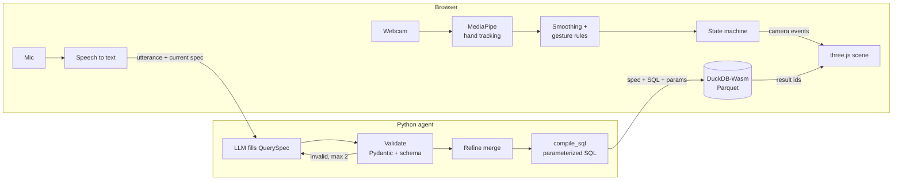

# AirQuery

<!-- Demo GIF goes here: record the hero take (docs/PRD.md), export ~10 s as
docs/media/demo.gif, then uncomment the next line.

-->

**[Try it live: mdsaifff.github.io/airquery](https://mdsaifff.github.io/airquery/)** (Chrome,
webcam and microphone; typing works too). Built by Mohammed Saif
([@mdsaifff](https://github.com/mdsaifff)).

**Explore a 3D dataset with your hands and ask questions out loud.** Hand tracking
moves the camera; your voice becomes a validated query that runs locally in DuckDB;
the scene re-renders in about a second. Runs in a browser on a normal laptop, no GPU.

The first scene is a year of earthquakes (USGS, 2024, M4.5+) plotted at their real
depth inside the globe. Say *"only show quakes deeper than 300 kilometres"*, then
*"colour them by magnitude"*, and watch the subducting slabs light up.

Five more scenes sit in the picker, or just say *"switch to the hurricane tracks"*:

| Scene | What you see | Try saying |
| --- | --- | --- |
| Earthquakes | 6.4k quakes of 2024 (M4.5+) at their real depth inside the globe | *"deeper than 300 km"*, *"the ten strongest"*, *"play the year"* |
| Hurricane tracks | 6.7k storm positions over three seasons, replayable | *"only category 4 and up"*, *"show hurricane Milton"*, *"play the year"* |
| Meteorite landings | 31.9k meteorites, sized by mass | *"the ten heaviest"*, *"only the ones seen falling"* |
| Deep-sea corals | 14.5k coral and sponge records, sunk to their depth (X-ray) | *"only sponges"*, *"deeper than 3 km"*, *"show me the deepest ones"* |
| Airports of the world | 72.6k airports, raised by elevation | *"only large airports"*, *"airports higher than 3000 metres"* |
| Star map | 15.2k stars in 3D around the Sun | *"stars within 50 light years"*, *"the ten brightest stars"*, *"only stars in Orion"* |

Follow-ups build on what is shown (*"only sponges"*, then *"only in the North Pacific"*), and
circling an area makes the globe say what is inside. Drop in your own CSV with latitude and
longitude too.

## How it works



- **The LLM never writes SQL.** It fills a typed `QuerySpec`; deterministic code
  validates it against the dataset schema (known columns, operators that fit the
  type, values in range) and compiles it to SQL with bound parameters.
- **Two loops, one scene.** Hand tracking runs every frame in the browser; the
  voice loop makes one round trip to the agent. Rendering never waits on either.
- **Nothing visual leaves the laptop.** Webcam frames stay in the browser; only
  the transcript text goes to the agent.
- **One contract, two languages.** `QuerySpec` is defined in Pydantic and the
  TypeScript types are generated from its JSON Schema; tests fail if they drift.

## Run it

Needs Node.js LTS, Python 3.12, [uv](https://docs.astral.sh/uv/) and GNU make.

```bash
cp agent/.env.example agent/.env   # paste a free Groq key (console.groq.com/keys) into LLM_API_KEY
make dev    # web on http://localhost:5173, agent on http://localhost:8000
make test   # Vitest + pytest
make lint
make data   # re-download and rebuild the Parquet + schema (the 2024 set is committed)
```

No API key yet? `cd agent && uv run python scripts/fake_agent.py` serves the real
agent with a keyword-matching stand-in for the LLM ("deeper than 300", "colour them
by magnitude", "the ten strongest", "near Japan", "undo", ...).

| Input | Hands | Keyboard / mouse |
| --- | --- | --- |
| Move cursor, hover a point | point (index finger up) | mouse |
| Rotate | pinch and drag | drag |
| Zoom | pinch with both hands, pull apart / together | wheel |
| Talk | point with one hand and raise the other, open; speak when the bar turns green (a soft tick) | hold **space**, or type in the box |
| Start over (camera home, filters cleared) | hold one open palm ✋ (1.2 s), or say "start over" / "undo" | **Z**; **R** resets only the camera |
| Freeze the scene while repositioning | closed fist ✊ | – |
| Switch scene | point at a scene name (top left) and hold still until the ring fills (~0.8 s), or say "switch to the …" | click it, or **←** / **→** |
| Select an area (the globe says what is inside) | pinch and hold still (~1 s, until the ring fills), then move out to size the circle and let go | **Shift**+drag, **Esc** clears |
| X-ray: see points at their real depth (quakes, corals) | – | **X**, or the button in the legend |
| What's this? (spoken summary) | say it | type it |

Raise your other hand (or hold Space) and speak. Besides filters you can say *play the year*, *pause*, *go to
March*, *faster*, *stop the replay*, *X-ray on*, *show / hide the stats*, *share this view*,
*be quiet*. Point at the globe and say *what happened here?*, *only quakes around here* or
*fly here*. The globe answers out loud and in a subtitle (🔊 toggles the voice). The
dashboard lights up what your filter covers. Quiet fallbacks: click the strip to jump to a
date, **L** plays or pauses, **Esc** leaves the replay; *Share this view* copies a link.

**V** chooses the voice that reads summaries aloud.

The first visit shows a short welcome; **↻ Replay** in the title bar replays 2024.
Set `quality: 'low'` in `web/src/config.ts` if the frame rate drops on your machine.
Drop any CSV with latitude/longitude columns onto the page to explore it.
Dev only: **D** tuning panel, **Shift+R** record a landmark fixture.

## Deploy

Two pieces, deployed separately:

| Piece | What | Build |
| --- | --- | --- |
| Web | Static files (`web/dist`) | `VITE_AGENT_URL=https://airquery-agent.onrender.com make build` |
| Agent | Docker image (FastAPI) | `make docker-agent` (= `docker build -f agent/Dockerfile -t airquery-agent .`) |

Check a production build locally against a local agent:

```bash
make docker-agent && docker run --env-file agent/.env -p 8000:8000 airquery-agent
VITE_AGENT_URL=http://localhost:8000 make preview      # http://localhost:4173
```

Agent environment variables (secrets on the host, never in the web build):
`LLM_PROVIDER`, `LLM_MODEL`, `LLM_API_KEY`, `WEB_ORIGIN` (comma-separated allowed
origins), `RATE_LIMIT_PER_MIN` (AI questions per visitor per minute, default 15),
`COMPILE_RATE_LIMIT_PER_MIN` (chart clicks and share links per visitor, default 60)
and `LLM_CALLS_PER_MIN` (AI questions from all visitors together, default 15 — set so one
visitor can explore freely; Groq's free token limit, ~8k/min, is the real ceiling under
sustained load). When a limit is hit, visitors see "the AI is busy; ask again in
a minute"; when the provider's daily cap is spent (Groq free: 200k tokens/day, about 90
questions), they are told to try again in a few hours.
The image reads its `DatasetSchema` files from
`/app/data` and listens on `$PORT` (default 8000).

**Hosts.** The repo is set up for GitHub Pages (website, `.github/workflows/pages.yml`)
and Render (agent, `render.yaml`), both free. Netlify or Vercel also work for the website;
Cloud Run, Fly.io or Railway for the agent. Cloudflare Pages does not: the DuckDB-Wasm
binaries are ~36–41 MB each, over its 25 MiB file limit.

**How this repo is deployed.**

- Website: https://mdsaifff.github.io/airquery/, rebuilt by the `pages` workflow on every
  push to `main`. The repo variable `AGENT_URL` (Settings → Secrets and variables →
  Actions → Variables) is `https://airquery-agent.onrender.com`.
- Agent: https://airquery-agent.onrender.com (Render blueprint from `render.yaml`), with
  `LLM_API_KEY` (Groq key) and `WEB_ORIGIN=https://mdsaifff.github.io` set on Render.
  `curl https://airquery-agent.onrender.com/health` returns `{"ok":true}`. The free plan
  sleeps when idle, so the first question after a quiet spell takes ~30 s.

To run your own copy, fork the repo, create a Render blueprint from it with your own key,
set `WEB_ORIGIN` to `https://<your-github-user>.github.io` and `AGENT_URL` to your agent,
then turn on Pages (Source: GitHub Actions) and run the `pages` workflow.

## Design decisions

Full log with context and consequences: `docs/DECISIONS.md`. Highlights:

- **three.js, not deck.gl** (D-001): the globe needs points *below* the surface and
  free camera pitch.
- **The LLM fills a spec, never SQL** (D-002): no injection, no hallucinated
  columns, explainable failures.
- **DuckDB-Wasm in a worker** (D-003): real SQL in milliseconds, no data leaves
  the laptop, no database server to host.
- **MediaPipe in its own frame-callback loop** (D-008): the JS API has no
  `LIVE_STREAM` mode, so tracking runs beside the render loop, never inside it.

## Repo map

`web/` Vite + React + TypeScript frontend (three.js used imperatively) ·
`agent/` FastAPI + LangGraph query service · `data_prep/` public datasets → Parquet +
schema · `docs/` spec, architecture, tasks, decisions.

## Privacy

Hand tracking runs fully in the browser; webcam frames never leave it. Only the
transcript text goes to the agent. Chrome's Web Speech API sends audio to Google
for recognition (D-004); the typed box is always available instead. The microphone is
on only while you talk (the green bar).

## Credits

Earth imagery: NASA Visible Earth (public domain): Blue Marble Next Generation
(R. Stöckli, NASA Earth Observatory), Black Marble 2016 city lights, and the
Blue Marble cloud composite. Built by `make textures`. Earthquakes: USGS.

Scenes built by `make data` (`data_prep/catalog.py`): meteorite landings, The Meteoritical
Society via NASA Open Data; airports, [OurAirports](https://ourairports.com/data/) (public
domain); hurricane tracks, NOAA NCEI IBTrACS v04r01 (doi:10.25921/82ty-9e16); deep-sea corals
and sponges, NOAA Deep Sea Coral Research and Technology Program National Database; stars,
the [HYG database](https://astronexus.com/hyg) v3 by David Nash, CC BY-SA 4.0, so
`web/public/data/stars.*` is shared under CC BY-SA 4.0 too.

## License

Code: [MIT](LICENSE) © 2026 Mohammed Saif. The datasets keep their own terms (see
Credits): the star map data is CC BY-SA 4.0.
