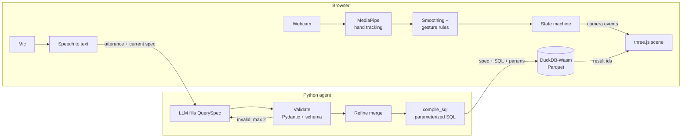

# AirQuery

<!-- Demo GIF goes here: record the hero take (docs/PRD.md), export ~10 s as
docs/media/demo.gif, then uncomment the next line.

-->

**Explore a 3D dataset with your hands and ask questions out loud.** Hand tracking
moves the camera; your voice becomes a validated query that runs locally in DuckDB;
the scene re-renders in about a second. Runs in a browser on a normal laptop, no GPU.

The first scene is a year of earthquakes (USGS, 2024, M4.5+) plotted at their real
depth inside the globe. Say *"only show quakes deeper than 300 kilometres"*, then
*"colour them by magnitude"*, and watch the subducting slabs light up.

More scenes sit in the picker (or say *"switch to the hurricane tracks"*): three seasons of
hurricane tracks you can replay, meteorite landings, deep-sea corals, the world's airports
and a 3D star map around the Sun. Drop in your own CSV with latitude and longitude too.

## How it works



- **The LLM never writes SQL.** It fills a typed `QuerySpec`; deterministic code
  validates it against the dataset schema (known columns, operators that fit the
  type, values in range) and compiles it to SQL with bound parameters.
- **Two loops, one scene.** Hand tracking runs every frame in the browser; the
  voice loop makes one round trip to the agent. Rendering never waits on either.
- **Nothing visual leaves the laptop.** Webcam frames stay in the browser; only
  the transcript text goes to the agent.
- **One contract, two languages.** `QuerySpec` is defined in Pydantic and the
  TypeScript types are generated from its JSON Schema; tests fail if they drift.

## Measured results

Measured on the demo laptop (Chrome, plugged in). Method: `docs/EVAL.md`.

| What | Target | Result |
| --- | --- | --- |
| Rendering | 60 fps | pending: HUD readout during a 2-min session |
| Hand tracking | ≥ 25 fps | pending: HUD readout |
| Voice → render latency (median) | < 1.5 s | pending: `make latency` (press **M** in the app for frontend timings) |
| Query accuracy, result-set match (115 utterances) | ≥ 90 % | pending: `make eval` |
| Gesture accuracy per gesture (5 people × 7 gestures × 20 tries) | ≥ 95 % | pending: study panel (**G**) + `make gestures` |
| False triggers while talking | < 1 per 5 min | pending: study panel counter |
| Invalid SQL reaching DuckDB | 0 | 0 by construction (every spec is validated, then compiled from a whitelist); checked by `make eval` |

Ablations (repair loop on/off, model tiers, accuracy vs cost vs latency) land in
`eval/reports/` via `make eval` + `make ablation`.

## Run it

Needs Node.js LTS, Python 3.12, [uv](https://docs.astral.sh/uv/) and GNU make.

```bash
cp agent/.env.example agent/.env   # paste a free Groq key (console.groq.com/keys) into LLM_API_KEY
make dev    # web on http://localhost:5173, agent on http://localhost:8000
make test   # Vitest + pytest (agent, data_prep, eval)
make lint
make data   # re-download and rebuild the Parquet + schema (the 2024 set is committed)
```

No API key yet? `cd agent && uv run python scripts/fake_agent.py` serves the real
agent with a keyword-matching stand-in for the LLM ("deeper than 300", "colour them
by magnitude", "the ten strongest", "near Japan", "undo", ...).

| Input | Hands | Keyboard / mouse |
| --- | --- | --- |
| Move cursor, hover a quake | point (index finger up) | mouse |
| Rotate | pinch and drag | drag |
| Zoom | pinch with both hands, pull apart / together | wheel |
| Talk | point with one hand and raise the other, open | hold **space**, or type in the box |
| Undo | say "undo" / "go back" | **Z** |
| Start over (camera home, filters cleared) | hold one open palm ✋ (1.2 s) | **R** resets the camera |
| Freeze the scene while repositioning | closed fist ✊ | – |
| Switch scene (globe ↔ paper galaxy ↔ your CSV) | swipe an open hand sideways | **←** / **→** |
| Select an area (the globe says what is inside) | pinch and hold still (~0.6 s), then move out to size the circle and let go | **Shift**+drag, **Esc** clears |
| X-ray: see quakes at their real depth | – | **X**, or the button in the legend |
| What's this? (spoken summary) | say it, or hold the custom gesture | type it |

Raise your other hand (or hold Space) and speak. Besides filters you can say *play the year*, *pause*, *go to
March*, *faster*, *stop the replay*, *X-ray on*, *show / hide the stats*, *share this view*,
*be quiet*. Point at the globe and say *what happened here?*, *only quakes around here* or
*fly here*. The globe answers out loud and in a subtitle (🔊 toggles the voice). The
dashboard lights up what your filter covers. Quiet fallbacks: click the strip to jump to a
date, **L** plays or pauses, **Esc** leaves the replay; *Share this view* copies a link.

Study tools: **G** gesture study + false-trigger counter, **B** mouse baseline
(dropdown filters), **T** task timer, **M** download frontend timings,
**C** record frames for a custom gesture (`notebooks/custom_gesture.ipynb`),
**V** choose the voice that reads summaries aloud.

The first visit shows a short welcome; **↻ Replay** in the title bar replays 2024.
Set `quality: 'low'` in `web/src/config.ts` if the frame rate drops on your machine.
Drop any CSV with latitude/longitude columns onto the page to explore it.
`make galaxy` builds the arXiv paper galaxy (needs a few GB of RAM).
Dev only: **D** tuning panel, **Shift+R** record a landmark fixture.

## Deploy

Two pieces, deployed separately:

| Piece | What | Build |
| --- | --- | --- |
| Web | Static files (`web/dist`) | `VITE_AGENT_URL=https://<agent-host> make build` |
| Agent | Docker image (FastAPI) | `make docker-agent` (= `docker build -f agent/Dockerfile -t airquery-agent .`) |

Check a production build locally against a local agent:

```bash
make docker-agent && docker run --env-file agent/.env -p 8000:8000 airquery-agent
VITE_AGENT_URL=http://localhost:8000 make preview      # http://localhost:4173
```

Agent environment variables (secrets on the host, never in the web build):
`LLM_PROVIDER`, `LLM_MODEL`, `LLM_API_KEY`, `WEB_ORIGIN` (comma-separated allowed
origins), `RATE_LIMIT_PER_MIN` (AI questions per visitor per minute, default 6),
`COMPILE_RATE_LIMIT_PER_MIN` (chart clicks and share links per visitor, default 60)
and `LLM_CALLS_PER_MIN` (AI questions from all visitors together, default 5; at ~2.1k
tokens each that is a little over a Groq free key's 8k tokens/min, so a busy minute may get
an occasional "the AI is busy" reply). When a limit is hit, visitors see "the AI is busy; ask again in
a minute".
The image reads its `DatasetSchema` files from
`/app/data` and listens on `$PORT` (default 8000).

**Hosts.** Web: Netlify, Vercel or GitHub Pages (the DuckDB-Wasm binaries are
~36–41 MB each, so Cloudflare Pages' 25 MiB file limit rules it out). Agent: Google
Cloud Run (set min instances = 1 while recording to avoid cold starts), Fly.io,
Render (free tier sleeps) or Railway.

**Deploy checklist.**

1. Deploy the agent (Render or Cloud Run) with the variables above and
   `WEB_ORIGIN=https://<your-site>`.
2. `curl https://<agent-host>/health` returns `{"ok":true}`.
3. `VITE_AGENT_URL=https://<agent-host> make build`.
4. Upload `web/dist` to Netlify (drag and drop, or `netlify deploy --prod --dir web/dist`).
5. Open the site: allow the camera, ask one question, press ▶ on the strip, then copy a share
   link and open it in a private window.

## Design decisions

Full log with context and consequences: `docs/DECISIONS.md`. Highlights:

- **three.js, not deck.gl** (D-001): the globe needs points *below* the surface and
  free camera pitch; one engine also covers the planned embedding galaxy.
- **The LLM fills a spec, never SQL** (D-002): no injection, no hallucinated
  columns, explainable failures, and evaluation by exact spec match.
- **DuckDB-Wasm in a worker** (D-003): real SQL in milliseconds, no data leaves
  the laptop, no database server to host.
- **MediaPipe in its own frame-callback loop** (D-008): the JS API has no
  `LIVE_STREAM` mode, so tracking runs beside the render loop, never inside it.
- **The mouse baseline compiles through the agent too** (D-010): both arms of the
  hands-vs-mouse study run identical, validated queries.

## Repo map

`web/` Vite + React + TypeScript frontend (three.js used imperatively) ·
`agent/` FastAPI + LangGraph query service · `data_prep/` USGS → Parquet +
schema · `eval/` utterance set, scoring, latency and gesture reports ·
`docs/` spec, architecture, tasks, decisions, evaluation protocol.

## Privacy

Hand tracking runs fully in the browser; webcam frames never leave it. Only the
transcript text goes to the agent. Chrome's Web Speech API sends audio to Google
for recognition (D-004); the typed box is always available instead.

## Credits

Earth imagery: NASA Visible Earth (public domain): Blue Marble Next Generation
(R. Stöckli, NASA Earth Observatory), Black Marble 2016 city lights, and the
Blue Marble cloud composite. Earthquakes: USGS. Built by `make textures`.

Scenes built by `make data` (`data_prep/catalog.py`): meteorite landings, The Meteoritical
Society via NASA Open Data; airports, [OurAirports](https://ourairports.com/data/) (public
domain); hurricane tracks, NOAA NCEI IBTrACS v04r01 (doi:10.25921/82ty-9e16); deep-sea corals
and sponges, NOAA Deep Sea Coral Research and Technology Program National Database; stars,
the [HYG database](https://astronexus.com/hyg) v3 by David Nash, CC BY-SA 4.0, so
`web/public/data/stars.*` is shared under CC BY-SA 4.0 too.
