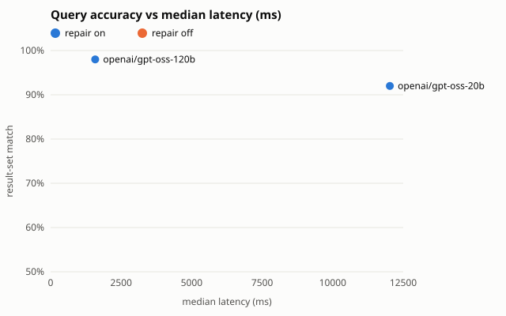

# Ablation (2026-10-15)

Repair loop on/off across model tiers, 100-utterance set (`eval/utterances.jsonl`).

| model | repair | result-set match | spec match | USD / 100 queries | median latency | invalid SQL |
| --- | --- | --- | --- | --- | --- | --- |
| openai/gpt-oss-120b | on | 98.0% | 97.0% | n/a | 1579 ms | 0 |
| openai/gpt-oss-20b | on | 92.0% | 90.0% | n/a | 12027 ms | 0 |

